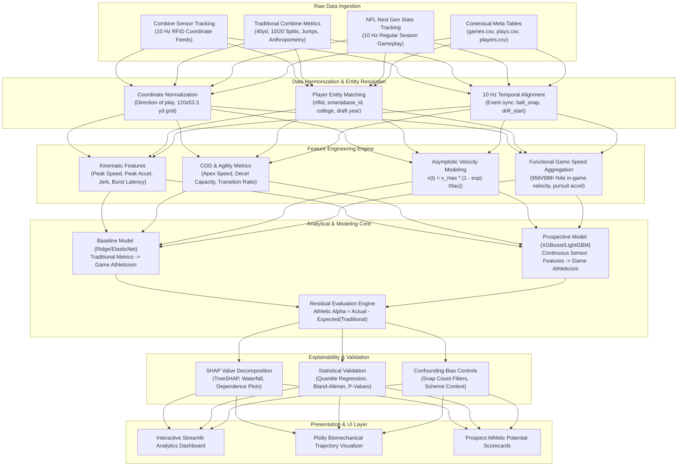

# ATHLETIX AI ⚡🏈
> **Beyond Speed. Understanding Athletic Potential.**

ATHLETIX AI is an advanced, competition-oriented sports analytics and machine learning research platform developed for the **NFL Big Data Bowl**. The project bridges pre-draft athletic evaluation and professional on-field performance by integrating high-frequency (10 Hz) RFID sensor tracking from the NFL Scouting Combine with regular-season Next Gen Stats (NGS) player tracking data.

---

## 🎯 Primary Research Question

> **"Can advanced movement analytics identify NFL prospects whose athletic potential is underestimated by traditional Combine measurements?"**

Traditional NFL draft evaluation relies heavily on discrete, stopwatch-measured Combine benchmarks—such as the 40-yard dash, short shuttle, and vertical jump. While these metrics capture isolated, static athletic ceilings in shorts and t-shirts, they frequently obscure continuous micro-movement capabilities:
* Acceleration burst latency ($\text{time-to-}a_{\max}$)
* Rate of force development (jerk: $\frac{da}{dt}$)
* Biomechanical change-of-direction (COD) apex velocity maintenance
* Deceleration-to-reacceleration transition efficiency
* Functional in-game speed translation relative to straight-line track speed

ATHLETIX AI tests the hypothesis that continuous sensor tracking reveals an **"Athletic Alpha"**—a latent athletic capability that explains why certain prospects outperform their draft capital and traditional testing expectations once on an NFL field.

---

## 🏛️ Technical Architecture



---

## 🔬 Core Research Principles

1. **Strict Empirical Grounding**: No fabricated datasets, synthetic player records, or hallucinated numbers. All modeling operates on official competition datasets.
2. **Causal Discipline**: High statistical correlation between sensor traits and in-game performance does not establish standalone causation. All findings are contextualized with scheme, role, and usage parameters.
3. **Prospective Validation**: Models are evaluated using temporal group cross-validation (splitting by draft class/season) to eliminate look-ahead leakage.

---

## 📁 Scalable Project Structure

```
athletics-ai/
├── data/
│   ├── raw/                       # Raw competition datasets (gitignored)
│   │   ├── combine_tracking/      # High-frequency Combine RFID drill tracking
│   │   ├── combine_traditional/   # Traditional stopwatch and jump records
│   │   ├── nfl_ngs_tracking/      # Regular season week-by-week tracking
│   │   └── context/               # games.csv, plays.csv, players.csv
│   ├── processed/                 # Feature-engineered parquet matrices
│   └── external/                  # Supplemental benchmark datasets
├── notebooks/                     # Exploratory Data Analysis & Research Notebooks
│   ├── 01_data_exploration_combine.ipynb
│   ├── 02_data_exploration_ngs_tracking.ipynb
│   ├── 03_feature_engineering_movement.ipynb
│   └── 04_statistical_modeling_and_shap.ipynb
├── src/                           # Production-grade Python package
│   ├── __init__.py
│   ├── config.py                  # Global paths, constants, field geometry
│   ├── data/                      # Ingestion, validation, entity resolution
│   │   ├── __init__.py
│   │   ├── loader.py
│   │   ├── matching.py
│   │   └── preprocessor.py
│   ├── features/                  # Biomechanical feature engineering
│   │   ├── __init__.py
│   │   ├── kinematics.py
│   │   ├── cod_metrics.py
│   │   └── tracking_aggregators.py
│   ├── models/                    # Baseline, predictive, and residual models
│   │   ├── __init__.py
│   │   ├── baseline.py
│   │   ├── prospective_model.py
│   │   ├── residual_evaluator.py
│   │   └── explainability.py
│   └── visualization/             # Plotly trajectories and research charts
│       ├── __init__.py
│       ├── trajectory_plots.py
│       └── metric_eval_plots.py
├── dashboard/                     # Interactive Streamlit application
│   ├── app.py
│   └── components/
├── tests/                         # Automated unit & integration tests
├── DATASET_GUIDE.md               # Detailed schema & download instructions
├── RESEARCH_METHODOLOGY.md        # Comprehensive mathematical & statistical formulation
├── requirements.txt               # Pinned Python dependencies
└── README.md                      # Project documentation
```

---

## 🛠️ Technology Stack

| Domain | Tools / Libraries |
| :--- | :--- |
| **Language & Environment** | Python 3.10+, JupyterLab |
| **Data Engineering** | Pandas, Polars, PyArrow, NumPy, SciPy |
| **Statistical Modeling** | Statsmodels, Scikit-learn |
| **Machine Learning** | XGBoost, LightGBM |
| **Model Interpretability** | SHAP (TreeSHAP) |
| **Interactive UI & Visuals** | Streamlit, Plotly, Seaborn, Matplotlib |
| **Spatial Geometry** | Shapely, GeoPandas |

---

## 🚀 Setup & Installation

### 1. Clone & Set Up Python Environment
```bash
# Clone the repository
git clone https://github.com/your-org/athletix-ai.git
cd athletix-ai

# Create virtual environment
python -m venv venv
# Windows:
venv\Scripts\activate
# Linux/macOS:
source venv/bin/activate

# Install dependencies
pip install -r requirements.txt
```

### 2. Dataset Acquisition
Follow the step-by-step instructions in [DATASET_GUIDE.md](DATASET_GUIDE.md) to place official competition files into `data/raw/`.

### 3. Launch Interactive Analytics Platform
Run the production Streamlit research platform:
```bash
streamlit run src/dashboard/app.py
```

### 4. Run Automated Test Suite
Verify all unit tests, sprint models, and UI components:
```bash
python -m pytest tests/ -v
```

---

## 📚 Official Research & Submission Documentation
* **Research Paper:** [reports/final_research_paper.md](reports/final_research_paper.md) — Comprehensive academic competition submission paper.
* **Executive Summary:** [reports/executive_summary.md](reports/executive_summary.md) — Strategic takeaways for NFL front offices and analytics directors.
* **Technical Methodology:** [reports/technical_methodology.md](reports/technical_methodology.md) — Mathematical derivations, nested CV, and bootstrap formulation.
* **Reproducibility Guide:** [reports/reproducibility_guide.md](reports/reproducibility_guide.md) — Complete environment and reproduction instructions.
* **Scientific Limitations:** [reports/limitations_and_future_work.md](reports/limitations_and_future_work.md) — Explicit boundary conditions and future directions.
* **Phase 4 Data Mapping:** [reports/phase4_data_mapping.md](reports/phase4_data_mapping.md) — Data traceability matrix.
* **Dashboard Validation Report:** [reports/phase4_dashboard_validation.md](reports/phase4_dashboard_validation.md) — Test checklist and performance audit.
* **Phase 3.1 Statistical Audit:** [reports/phase3_1_audit/statistical_audit_report.md](reports/phase3_1_audit/statistical_audit_report.md) — Independent statistical audit verdicts.
* **Dataset Guide:** [DATASET_GUIDE.md](DATASET_GUIDE.md) — Raw competition dataset documentation.
