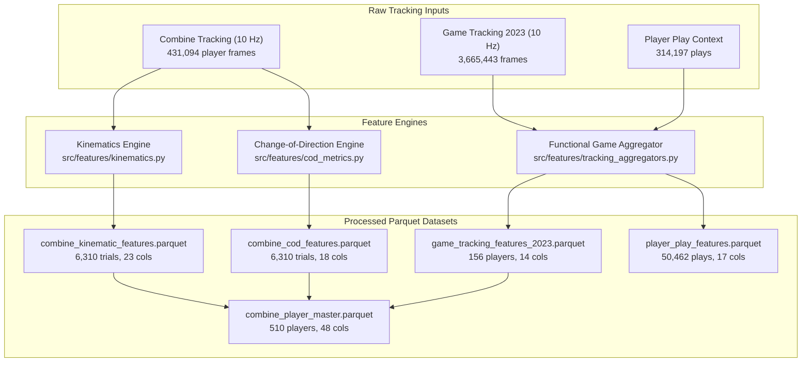

# ATHLETIX AI: Phase 2 Feature Engineering Report 🔬⚙️

**Date**: November 2026  
**Subject**: Advanced Movement Intelligence Feature Extraction across Combine and NFL Game Tracking.  
**Primary Research Question**:
> *"Can advanced movement analytics provide additional information about functional NFL athleticism beyond traditional Combine measurements?"*

---

## 1. Feature Engineering Architecture

The Movement Intelligence Engine converts 10 Hz continuous sensor coordinates $(x_t, y_t)$, velocity $s_t$, and acceleration magnitude $a_t$ into scientifically defensible biomechanical features:

---

## 2. Combine Kinematic Features (`src/features/kinematics.py`)

Processed across **$6,310$ distinct drill trials** for all **$510$ prospects**:

| Metric | Mathematical Definition | Empirical Mean | Empirical $95\text{th}$ %ile | Analytical Role |
| :--- | :--- | :--- | :--- | :--- |
| **$v_{\max}$** | $\max_t(s_t)$ | $7.94\text{ yd/s}$ | $10.79\text{ yd/s}$ | Peak speed capacity across drills |
| **$v_{\text{mean}}$** | $\frac{1}{N}\sum s_t \; (s_t \ge 0.5\text{ yd/s})$ | $5.21\text{ yd/s}$ | $8.13\text{ yd/s}$ | Sustained movement velocity |
| **$a_{\text{init}}$** | $\frac{1}{10}\sum_{t=0.1}^{1.0} a_t$ | $2.83\text{ yd/s}^2$ | $4.84\text{ yd/s}^2$ | First-second burst acceleration capacity |
| **$a_{\max}$** | $\max_t(a_t)$ | $5.94\text{ yd/s}^2$ | $8.14\text{ yd/s}^2$ | Peak instantaneous acceleration |
| **$t_{v_{\max}}$** | $\arg\max_t(s_t) \cdot \Delta t$ | $3.46\text{ s}$ | $8.40\text{ s}$ | Latency to reach top speed |
| **$t_{0.9v_{\max}}$** | $\min\{t \mid s_t \ge 0.90 v_{\max}\}$ | $2.44\text{ s}$ | $7.20\text{ s}$ | Time to $90\%$ speed ceiling |
| **Burst Latency** | $\arg\max_t(a_t) \cdot \Delta t$ | $1.18\text{ s}$ | $3.60\text{ s}$ | Time to peak force generation |
| **Mean Positive Jerk** | $\frac{1}{|J^+|}\sum \frac{\Delta a}{\Delta t} \; (\frac{\Delta a}{\Delta t} > 0)$ | $3.30\text{ yd/s}^3$ | $5.89\text{ yd/s}^3$ | Rate of force development surrogate |
| **$a_{\text{decel, max}}$** | $\min_t(\frac{s_t - s_{t-1}}{\Delta t})$ | $-3.07\text{ yd/s}^2$ | $-0.07\text{ yd/s}^2$ | Peak eccentric braking force |

### Mono-Exponential Sprint Velocity Profile
For straight-line sprint trials (`FORTY_YARD_DASH`), we fit the mono-exponential differential model:
$$v(t) = v_{\max} \cdot \left(1 - e^{-t / \tau}\right)$$

* **Total Sprint Trials Evaluated**: $793$
* **Fit Success Rate**: **$793$ / $793$ ($100.0\%$)**
* **Goodness of Fit**: Mean **$R^2 = 0.9899$** (Min $R^2 = 0.5999$)
* **Mean Fitted $v_{\max}$**: $10.95\text{ yd/s}$ ($pprox 22.4\text{ mph}$)
* **Mean Fitted $\tau$**: $1.46\text{ s}$ (Acceleration time constant)

---

## 3. Change-of-Direction (COD) Engine (`src/features/cod_metrics.py`)

### Circular Angle Trigonometry
To prevent $0^\circ / 360^\circ$ wrapping artifacts, directional angular differences are computed via:
$$\Delta \theta_t = ((\theta_t - \theta_{t-1} + 180^\circ) \pmod{360^\circ}) - 180^\circ$$
$$\omega_t = \frac{|\Delta \theta_t|}{\Delta t} \quad (\text{deg/s})$$

### Turn Detection Algorithm
1. Identifies local speed minima ($s_t \le s_{t-1}$ and $s_t \le s_{t+1}$).
2. Validates directional cut criteria: $\omega_t \ge 45^\circ/\text{s}$ or cumulative 7-frame heading change $\ge 40^\circ$.
3. Extracts entry speed $v_{\text{entry}} = \max(s_{[t-3, t]})$, apex speed $v_{\text{apex}} = s_t$, and exit speed $v_{\text{exit}} = \max(s_{[t, t+3]})$.

### Empirical Findings:
* **Mean Turn Entry Speed**: $4.43\text{ yd/s}$
* **Mean Turn Apex Speed**: $2.44\text{ yd/s}$
* **Speed Preservation Ratio ($\eta_{\text{COD}}$)**: Mean $= 0.569$ ($56.9\%$ of velocity preserved through cut)
* **Peak Angular Velocity**: Mean $= 466.8^\circ/\text{s}$, $95\text{th}$ %ile $= 806.9^\circ/\text{s}$
* **Turning Efficiency Index**: Mean $= 216.5\text{ yd}\cdot^\circ/\text{s}^2$

---

## 4. In-Game Tracking Aggregators (`src/features/tracking_aggregators.py`)

Using `game_tracking_2023.csv` and `player_play.csv`:
* **Player Tracking Cohort**: $156$ rookie prospects active in 2023 regular-season competition.
* **Eligible Prospects ($\ge 50$ scrimmage snaps)**: **$149$ / $156$ ($95.5\%$)**.
* **$v_{\text{game, p95}}$**: Mean $= 6.37\text{ yd/s}$ ($13.03\text{ mph}$), Max $= 7.85\text{ yd/s}$ ($16.06\text{ mph}$).
* **$v_{\text{game, p99}}$**: Mean $= 7.43\text{ yd/s}$ ($15.20\text{ mph}$), Max $= 9.68\text{ yd/s}$ ($19.80\text{ mph}$).
* **$v_{\text{game, max}}$**: Mean $= 8.72\text{ yd/s}$ ($17.84\text{ mph}$), Max $= 10.74\text{ yd/s}$ ($21.97\text{ mph}$).
* **High-Speed Running Exposure ($s \ge 6.0\text{ yd/s}$)**: Mean $= 13.2\%$ of active frames.
